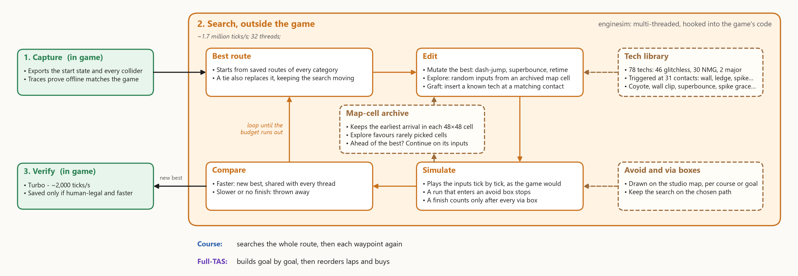

# IGTAP TAS Studio

Tool-assisted speedruns for *IGTAP: an Incremental Game That's Also a Platformer*. A plugin puts a studio inside the
game, an offline copy of the game's code searches for faster routes, and the game itself checks every route before it
is saved.



## What it does

- **Course records:** the fastest route for each unlock category
- **Full-TAS runs:** whole-game runs from a new game, goal by goal
- **TAS editor:** frame-by-frame editing on the live game
- **Tech library:** 78 named techs, each with a playable demo

Every route has to be playable by a human on a real controller. What counts: [`RULES.md`](RULES.md).

## Build and run

```powershell
dotnet build .\plugin\IGTAPTasMod.csproj -c Release     # web studio + plugin, copied into the game
```

The game is the Steam install (`IGTAP_GAME` overrides the path). Close it before building, since the plugin DLL is
locked while it runs. Start the game, then open the studio at <http://127.0.0.1:17426/>.

Running searches by hand: [`enginesim/README.md`](enginesim/README.md#use).

## More

- [`RULES.md`](RULES.md): what makes a route legal
- [`docs/fulltas.md`](docs/fulltas.md): whole-game runs and how they're solved
- [`docs/internals.md`](docs/internals.md): code layout, the studio, the TAS editor
- [`docs/human-input.md`](docs/human-input.md): what a human can put into the game
- [`docs/fidelity-log.md`](docs/fidelity-log.md): where offline and the game disagreed, and the fixes
- [`AGENTS.md`](AGENTS.md): notes for AI agents working in this repo
